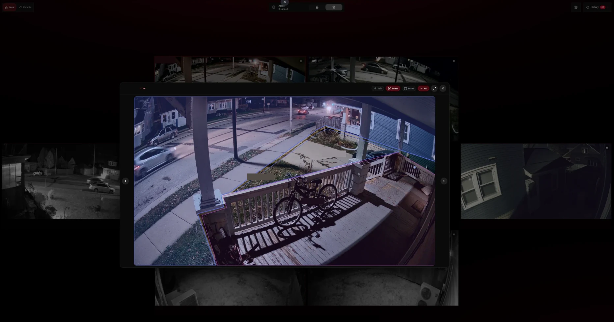
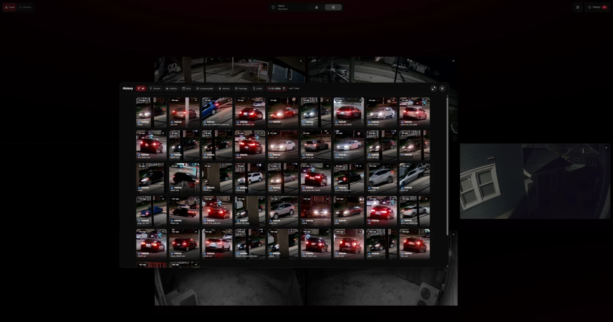

# Protect Detections

A Home Assistant custom integration that brings UniFi Protect's smart detections to your dashboards, together with the cards that show them:

- **Camera wall** – a screen-fitting wall of live camera feeds that you can arrange, with a live dialog (zoom, two-way talk, live boxes) and a detection history.
- **Detection history** – a lightbox of past detections that plays Protect's recording with Protect's own boxes drawn frame by frame.
- **Tracking card** – stands by with no video until a camera tracks a person, then shows that camera live and zoomed in on them.

It is a companion to Home Assistant's built-in **UniFi Protect** integration. It uses that integration's existing connection and login, and holds no credentials of its own.

> **Unofficial.** This project is not affiliated with Ubiquiti. Parts of it use interfaces of UniFi Protect that are not documented (the same ones Protect's own web app uses). A Protect update can change or remove them; features that depend on them then stop working until this integration is updated.

## Screenshots

| | |
|---|---|
|  |  |
| The camera wall, with a tracking tile standing by | A camera's live dialog, with zones |
|  |  |
| The detection history | A detection's recording, with Protect's boxes |

Camera and zone names are painted out in these pictures.

## Requirements

- Home Assistant 2026.3 or newer.
- The built-in **UniFi Protect** integration, set up and working.
- The **Protect Zones** custom integration (see [Companions](#companions)). Protect Detections uses the shared connection to Protect that Protect Zones provides and cannot be set up without it. Only its files need to be installed; you do not have to add it under Devices & services (though you will want to, for the zone features).
- For recorded clips: `ffmpeg`, which Home Assistant already ships.
- For live video in the cards: Home Assistant's own camera streaming (WebRTC through go2rtc, which Home Assistant sets up by default).

## Installation

### HACS (custom repository)

1. Install **Protect Zones** first, the same way (its repository is listed under [Companions](#companions)).
2. In HACS, open the menu, choose **Custom repositories**, add `https://github.com/OnticEntia/protect-detections` and select the type **Integration**.
3. Find **Protect Detections** in HACS, download it, and restart Home Assistant.
4. Go to **Settings → Devices & services → Add integration**, search for **Protect Detections** and confirm.

### Manual

1. Copy the folder `custom_components/protect_detections` from this repository into the `custom_components` folder of your Home Assistant configuration.
2. Do the same for Protect Zones.
3. Restart Home Assistant and add the integration as in step 4 above.

### The cards need no setup

The cards are part of the integration. It serves them itself and tells Home Assistant to load them, so there is **no dashboard resource to add**. After installing or updating, refresh the browser once.

If you used an earlier version that had you add `camera-wall-card.js`, `protect-detection-card.js` or `protect-tracking-card.js` as dashboard resources, remove those resources.

## The cards

Every card works with just its `type:`. What is left out is looked up in Home Assistant.

### Camera wall

```yaml
type: custom:camera-wall-card
```

Best in a view of type *Panel*. With no options it shows one feed per UniFi Protect camera (by name), the alarm panel if there is one, a History button, and a Local / Remote switch when Home Assistant knows both its internal and external address.

- **Tap a feed** to open it in a dialog: digital zoom (wheel, pinch, drag), HD toggle, two-way talk on cameras with a speaker, and a *Boxes* button on cameras that recognise things.
- **Arrange** (the button beside History): drag feeds to any cell of a grid, resize them, add or remove rows and columns. On a phone the wall is a list and arranging changes its order.
- **Right-click** (press and hold on a touch screen) for a menu: resize a tile, take it off the wall or put it back, add or remove a camera's tracking tile.
- The arrangement is saved for each Home Assistant user and follows them to every device.
- **Editing from the wall** (administrators): the right-click menu has *Edit the wall…*, which opens Home Assistant's card editor on the wall itself and saves into the dashboard, and on a tracking tile *Edit this tracker…*, which opens the tracking card's editor (what it watches for, sound, standby look, source and so on) for that tile. A tile's settings are kept with your own arrangement, not in the dashboard; only what differs from the wall's `tracking:` options is stored. A dashboard kept in YAML is edited in its file.
- The wall has a visual editor for its options. The camera lists, `alarm: false`, `alarm_modes`, `breakpoints` and options under `tracking:` stay YAML.

| Option | Default | What it does |
|---|---|---|
| `cameras` | found | A list of `{entity, tap_entity, name}` to use instead of the cameras that are found. `entity` is shown on the wall, `tap_entity` in the dialog. |
| `exclude` | – | Found cameras to leave out: names (`*` and `?` allowed), entity ids or device ids. |
| `order` | by name | Found cameras to put first, in this order. |
| `alarm` | found | An `alarm_control_panel` entity, or `false` for none. |
| `alarm_modes` | `[armed_home, armed_away, disarmed]` | The modes offered. |
| `history` | found | A camera list like `cameras` for the History lightbox, or `false` for none. |
| `local_url`, `remote_url` | from Home Assistant | The two addresses for the Local / Remote switch, or `false`. |
| `aspect_ratio` | `1.7778` | Width / height of each feed. |
| `breakpoints` | `[[1024, 3], [600, 2], [0, 1]]` | `[minimum screen width, columns]`. |
| `arrange` | `true` | `false` hides the Arrange button. |
| `layout` | `default` | A name for this wall's saved arrangement, if you have several walls. |
| `tracking` | on | `false` for no tracking tiles, or options for them (see the tracking card), e.g. `{types: [person], stream: low}`. |
| `live_tracks` | `true` | `false` hides the Boxes button. |
| `live_delay` | `700` | Milliseconds the live picture is held back while Boxes is on, so boxes line up with it. |
| `live_offset` | `0` | Milliseconds to draw the boxes later (+) or earlier (−). |
| `live_debug` | `false` | `true` writes on the live picture how the boxes are being timed (see Troubleshooting). |
| `source` | `auto` | Whose positions the live boxes and tracking tiles use: `auto`, `local` or `protect` (see [Protect Tracker](#companions)). |
| `zone_overlay` | `true` | `false` never shows zones (needs Protect Zones' overlay). |
| `phone_landscape` | `true` | `false` keeps the dialog upright on a phone. |

### Detection history

```yaml
type: custom:protect-detection-card
```

Takes no space on the page by itself; the camera wall creates one for its History button. On its own it is opened by another card or script calling `open()` on it. The lightbox lists finished detections with Protect's best photo of each object, filtered by kind, for the last 7 days or a chosen day. Tapping one plays Protect's recording with boxes, labels, paths, a face close-up, the boxes of other detections at the same moment, and *Follow* (zoom in on what was detected).

| Option | Default | What it does |
|---|---|---|
| `cameras` | found | A list of `{entity, tap_entity, name}`. |
| `exclude`, `order` | – | As on the camera wall. |
| `aspect_ratio` | `1.7778` | Width / height of the player. |
| `protect_url` | from the camera's device | The address of your Protect console, for the link on a detection's id. |
| `protect_event_url` | `{base}/protect/events/event/{id}` | The pattern of that link (`{base}`, `{id}`, `{camera}`), or `false` for no link. |

### Tracking card

```yaml
type: custom:protect-tracking-card
```

Watches every camera that recognises things and shows whichever one sees a person first. While standing by no video plays: it shows a still picture and a scanner animation.

| Option | Default | What it does |
|---|---|---|
| `camera` | all that recognise things | One camera entity to watch. |
| `types` | `[person]` | What to react to: `person`, `vehicle`, `animal`, `package`. |
| `show_others` | `false` | Also box other things, faintly. |
| `name` | the camera's | Shown while standing by. |
| `linger` | `10` | Seconds the picture stays after the last sighting. |
| `standby` | `radar` | The standing-by look: `radar`, `pulse`, `scanline` or `none`. |
| `accent` | the theme's primary colour | The scanner's colour. |
| `snapshot` | `60` | Seconds between still pictures while standing by; `0` for none. |
| `warm` | `false` | `true`: the live picture while standing by too (see below), so it is there at once when someone appears. |
| `stream` | `auto` | `auto` (best stream on the home network, lighter one elsewhere), `high` or `low`. |
| `max_zoom` | `4` | How far it zooms in. |
| `box_style` | `reticle` | How the followed thing is marked: `reticle` (the scanner's brackets close onto it, follow it and let it go) or `plain` (a box, with what it is in chips below). |
| `split` | `off` | `2`, `3` or `4`: with several things moving at once, a pane for each, up to that many (see below). |
| `aspect_ratio` | `1.7778` | Width / height, where the view does not set the height. |
| `height` | – | A fixed height instead (`300`, `300px`, `40vh`). |
| `live_delay`, `live_offset`, `live_debug` | `700`, `0`, `false` | As on the camera wall. |
| `source` | `auto` | Whose positions it follows: `auto`, `local` or `protect` (see [Protect Tracker](#companions)). |
| `sound` | `none` | A sound when it starts following: `ping` (a rising ping), `chirp` (a two-tone scanner chirp), `sweep` (a soft sweep) or `lock` (three blips and a tone). |
| `sound_volume` | `0.5` | How loud, from `0` to `1`. |
| `sound_gap` | `25` | Seconds the card stays quiet after it has sounded. |

**Whom it follows.** The thing that wakes the card is its subject, and the view stays on that one alone: while it stands still, through short losses, and when its reports carry on under another id. Things standing still (a parked car, a bike on the porch) never wake the card, never become the subject and never widen the view. Whether a thing is moving is judged by its box as well as by what its reports say: one that only wobbles in place counts as standing still even when it is reported as moving, except in its first second and a half in view, so that someone walking in is seen at once. When the subject has gone and something else of a watched kind is moving, the view goes over to the nearest such thing, once; a tap on another box makes that one the subject. With nothing moving left the card stands by again after `linger`, whatever is parked in view. A subject that is not a person and hasn't moved for `linger` seconds has parked, and is let go. A subject is followed by its id only as far as that makes sense: if its box comes to rest where something of its kind has been standing (a tracker can hand a passing car's id to a parked car it drove past), or jumps across the picture, it counts as lost there and is not followed.

**One look (`box_style: reticle`).** The standing-by scanner and the box round the followed thing are the same brackets, in the card's `accent` colour. On waking, the reticle flies to the thing and takes its shape while the sweep and rings fall in towards it, and the brackets close on it as the picture comes up. While following, a tag on the brackets says what it is, how sure, and which zones it is in. The edges are solid for a box made by Protect Tracker and dashed for one of UniFi Protect's; the brackets are dimmer on a thing standing still and breathe gently on a sure one; other moving things of a watched kind get faint brackets in their kind's colour, and a face a small set of its own. When the subject is lost the brackets stay where it was and pulse; when another becomes the subject they move across; and on standing by again the reticle opens back out from where the brackets were. With "reduce motion" set on the device there are no flights or pulsing. `box_style: plain` gives the earlier plain boxes.

**Several things at once (`split`).** By default the card stays on its one subject. With `split: 2` (up to `4`), once a second thing of a watched kind has been moving for a second, the picture splits into panes, one each, every pane zoomed in on its own thing. A thing keeps its pane while it is there; with one left for a second and a half it is one view again. The panes are cut from the one stream that is playing, so no second stream is opened; it costs a small copy of the picture per pane per frame. Parked things get no pane, and a card smaller than about 260 × 150 px never splits. Two panes sit side by side in a wide card and one above the other in a tall one; three or four make a 2 × 2 grid.

**Live picture while standing by (`warm`).** With `warm: true` the camera's stream runs all the time the card is on screen, and standing by shows that live picture, dimmed, under the scanner and the text, in place of the still. When someone appears the same picture brightens and zooms in: nothing is swapped. Until the stream has a picture, and if it loses it, the still is shown. With `standby: none` the live picture is shown plain, not dimmed. The live picture is always shown whole, so in a card that isn't the camera's shape it has bars where the still would fill the card. With several cameras the first one is the one kept running. What it costs: a constant stream from Home Assistant and continuous video decoding on the device, which on a phone or tablet means battery, heat and mobile data; off screen or in a background tab the stream stops, as before.

**Sound.** The sounds are made in the browser (no sound files) and play on the device showing the dashboard. A sound plays once when the card goes from standing by to following, not for every report, and not again until the card has stood by again and `sound_gap` has passed. Several tracking cards waking at the same moment make one sound. Things to know:

- A browser plays no sound on a page until it has been clicked or typed on. Until then the speaker mark in the card's corner is highlighted; any click on the page clears it.
- A click on the speaker mark turns the sound off or on for that browser (all tracking cards in it).
- The card listens only while it is on screen and its tab is in front, so a tab in the background makes no sound.
- In the card's editor, every click on a sound plays it, the one already picked included, and letting go of the volume slider plays the picked sound at the new volume. If nothing can be heard (sound turned off in this browser, or a browser without Web Audio), the editor says so beside the picker.

In a *Sections* view the card can be dragged to any width and height.

The card's editor shows, for everything the config leaves out, what the card does by default. Those defaults are not written to the config; only what you change is.

"Last seen" comes from the integration's own record (below), so it is the same on every device and counts people who came by while no dashboard was open.

## The record of live sightings

The integration listens to the live tracking of every camera that recognises things, all the time, and remembers what it reported:

- when each kind of thing (person, vehicle, …) was last seen on each camera;
- the newest 100 sightings per camera and kind: start, end, peak confidence, the zones, loiter zones and lines it was in, and Protect's event ids;
- when a camera's feed was not connected, so "nothing was seen" can be told from "nothing was listening".

With the Protect Tracker integration in its local mode, what its own model sees is recorded here as well. Each sighting says who saw it (`source`: `protect` or `local`) and whether Protect reported the same thing too (`attached`, with Protect's track id and event ids); a thing reported by both is one sighting. So "Last seen" also counts what only the tracker saw, and such a sighting can be found afterwards (`source: local`, `attached: false`). Still times, kinds and places only: no pictures.

It is kept in Home Assistant's `.storage` folder and survives a restart. To read it, call the websocket command `protect_detections/live/seen` (Developer tools → Actions cannot do this; use a card, a script against the websocket API, or the browser console). It takes optional `entity` (one camera), `types`, `limit` (default 50; `0` for the last-seen times only) and `since` (ms).

**What it costs:** one extra connection to the Protect console per camera that recognises things, open all the time, carrying a few small messages a second while that camera tracks something. **To turn it off:** Settings → Devices & services → Protect Detections → Configure. Live tracking is then listened to only while a dashboard shows it, and "Last seen" goes back to what each browser saw itself.

## Companions

Both are optional features of the cards, but see the note on Protect Zones.

- **[Protect Zones](https://github.com/OnticEntia/protect-zones)** – **required** for this integration to load, because it provides the connection to Protect that both share. It also adds what the cards use for zones: the zone overlay in the camera dialog, zone editing for administrators, "occupied" badges on the wall, and zone names in the tracking card.
- **[Protect Rules](https://github.com/OnticEntia/protect-rules)** – rules on top of detections. Its card uses this integration's clip player. Not needed otherwise.

- **Protect Tracker** – optional. An integration that follows things frame by frame on your own machine and sends their positions in the same form as Protect's, as often as the camera has frames. With `source: auto` (the default) the cards use it when it is installed and Protect's own positions (about four a second) when it isn't; it is found by itself if installed later. `source: local` asks it for its local mode (what its own model sees, with Protect's details added when Protect reports the same thing), and the card says so if it is missing or too old for that; `source: protect` never uses it. In the camera wall's live view a chip beside *Boxes* shows the choice and switches it with a click, remembered in the browser: **Auto** (Protect Tracker's boxes where it has them, Protect's own otherwise, drawn dashed), **Local** (what Protect Tracker's own model sees, under its own judgement, whether or not Protect reports it; a thing Protect hasn't reported yet has dotted edges; the chip says so when the model has nothing, when Protect Tracker isn't installed, or when it is a version from before this mode) and **UniFi** (only Protect's own, nothing from Protect Tracker). The chip appears once Protect Tracker has been seen. On the tracking card, `source: local` likewise reacts only to what the model made, and a small "local" or "Protect" mark shows whose positions it is following. A face it finds on a person it is following is drawn as a small box with that person; it never wakes a tracking card by itself.

HACS installs one repository at a time and does not install Protect Zones for you. If it is missing, adding Protect Detections stops with "Protect Zones isn't installed"; an entry that already exists fails to set up with the same message and a notice appears under **Settings → Repairs**. Install Protect Zones, restart Home Assistant, and reload Protect Detections.

## Privacy and security

- **Everything stays local.** The integration talks only to your Protect console, through the UniFi Protect integration's session. Nothing is sent anywhere else.
- **It relays camera data to dashboards.** Any logged-in Home Assistant user can see detections, object photos, recorded clips and live positions through this integration, and can talk through a camera's speaker. It does not add per-user restrictions of its own. Give dashboard access accordingly.
- **A record of sightings is kept.** When and where (which zones) each kind of thing was seen by live tracking is stored in Home Assistant's `.storage` folder: times, kinds and zone numbers, no pictures. See [The record of live sightings](#the-record-of-live-sightings) to turn it off.
- **Clips are written to disk.** A played clip is exported from Protect into the system's temporary folder on the Home Assistant machine. Only the newest 24 clips are kept (600 MB at most), and the folder is emptied when the integration starts and stops.
- **Talk** sends your browser's microphone audio to the camera's speaker. Browsers only allow the microphone over https; on a plain http address the wall opens a small talk window on your https address instead.
- **The card files are public**, like Home Assistant's own frontend files: they contain code only, no data, and are served without a login.
- **Nothing is written to Protect** by this integration. (Zone editing is done by Protect Zones and is limited to administrators there.)

## Troubleshooting

| Symptom | What to check |
|---|---|
| "Set up the UniFi Protect integration first" | The built-in UniFi Protect integration must be set up and loaded. |
| "Protect Zones isn't installed" (when adding, on the entry, or under Repairs) | Install Protect Zones, restart Home Assistant, then add or reload Protect Detections. |
| "Custom element doesn't exist" for a card | Refresh the browser (clear its cache if needed) after installing or updating. Check that the integration is loaded. |
| A card shows twice-defined errors in the browser console | Remove old dashboard resources pointing at these cards; the integration loads them now. |
| No Boxes button, no tracking tile | The camera must recognise things (smart detections), and the integration must be a version with live tracking. |
| Boxes sit ahead of or behind the picture | The boxes are right in place; what can be off is time. Set `live_debug: true` and read the line on the picture. "by frame timestamps" (WebRTC in a browser that reports them) goes by each frame's own time; with `live_debug` on, the card then also checks the timing against the picture ("picture check: fits at … ms", after a minute or so of things moving) and that figure should match the "stamp" figure beside it. "by estimate" is a best guess: fair on WebRTC, rough on HLS, where `live_offset` is the trim (positive if the boxes run ahead of things, negative if they trail). |
| Clips do not play | The camera must be recording in Protect for the time of the detection. Some browsers cannot play HEVC; the card then asks for an H.264 copy, which takes a little longer. |
| No talk button | The camera needs a speaker, and the page must be on https (or the talk window is used). |
| The tracking card didn't react to someone | Ask `protect_detections/live/seen` for that time. A sighting of the right kind means Protect reported them and the card wasn't listening (it listens only while on screen). A gap means the feed was down. Neither means Protect's live tracking didn't report them. |
| Something stopped working after a Protect update | Protect's undocumented interfaces may have changed. Please open an issue with your Protect and Home Assistant versions. |

## Development

The cards are plain JavaScript modules in `custom_components/protect_detections/frontend/`, with no build step. Their tests run in Node without a browser:

```bash
node tests/cards.test.mjs
```

## Licence

MIT. See [LICENSE](LICENSE).
