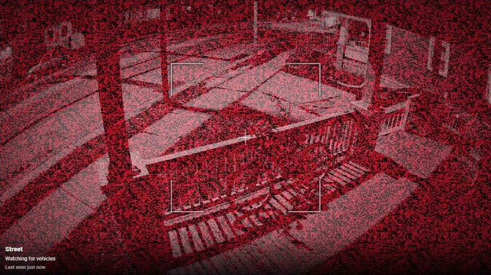

# Protect Detections

A Home Assistant custom integration that brings UniFi Protect's smart detections to your dashboards, together with the cards that show them:

- **Camera wall** – a screen-fitting wall of live camera feeds that you can arrange, with a live view (zoom, two-way talk, live boxes on what the camera is tracking), tracking tiles, and a detection history.
- **Detection history** – a lightbox of past detections that plays Protect's recording with Protect's own boxes drawn frame by frame.
- **Tracking card** – stands by until a camera tracks a person (or whatever you tell it to watch for), then shows that camera live, zoomed in on them and staying on them, and stands by again when they have gone.

It also keeps a small **record of live sightings** (when each kind of thing was last seen, and where), so that "Last seen" is the same on every device.

It is a companion to Home Assistant's built-in **UniFi Protect** integration. It uses that integration's existing connection and login, and holds no credentials of its own.

> **Unofficial.** This project is not affiliated with Ubiquiti. Parts of it use interfaces of UniFi Protect that are not documented (the same ones Protect's own web app uses). A Protect update can change or remove them; features that depend on them then stop working until this integration is updated.

## Screenshots

| | |
|---|---|
|  |  |
| The camera wall, with a tracking tile standing by | A camera's live view: zones and live boxes |
|  |  |
| The detection history | A detection's recording, with Protect's boxes |



The tracking card standing by, in the `static` look.

Camera and zone names are painted out in these pictures.

<!-- screenshot: tracking card standing by, radar look (default options) -->
<!-- screenshot: tracking card following a person: reticle brackets, tag, face inset (default options; a person in view) -->

## Requirements

- Home Assistant 2026.3 or newer.
- The built-in **UniFi Protect** integration, set up and working.
- The **Protect Zones** custom integration (see [Companions](#companions)). Protect Detections uses the shared connection to Protect that Protect Zones provides and cannot be set up without it. Only its files need to be installed; you do not have to add it under Devices & services (though you will want to, for the zone features).
- For recorded clips: `ffmpeg`, which Home Assistant already ships.
- For live video in the cards: Home Assistant's own camera streaming (WebRTC through go2rtc, which Home Assistant sets up by default).
- For live boxes and tracking: a camera that recognises things (Protect's smart detections).

Nothing else is required.

## Installation

### HACS (custom repository)

1. Install **Protect Zones** first, the same way (its repository is listed under [Companions](#companions)).
2. In HACS, open the menu, choose **Custom repositories**, add `https://github.com/OnticEntia/protect-detections` and select the type **Integration**.
3. Find **Protect Detections** in HACS, download it, and restart Home Assistant.
4. Go to **Settings → Devices & services → Add integration**, search for **Protect Detections** and confirm.

### Manual

1. Copy the folder `custom_components/protect_detections` from this repository into the `custom_components` folder of your Home Assistant configuration.
2. Do the same for Protect Zones.
3. Restart Home Assistant and add the integration as in step 4 above.

### The cards need no setup

The cards are part of the integration. It serves them itself and tells Home Assistant to load them, so there is **no dashboard resource to add**.

After installing or updating, **reload the page** in every browser, and **refresh the Home Assistant app** on phones and tablets (pull down on the dashboard, or *Settings → Companion app → Debugging → Reset frontend cache*). The app keeps its page open for days, and until it is refreshed it goes on running the cards it loaded before.

If you used an earlier version that had you add `camera-wall-card.js`, `protect-detection-card.js` or `protect-tracking-card.js` as dashboard resources, remove those resources.

## The cards

Every card works with just its `type:`. What is left out is looked up in Home Assistant. The camera wall and the tracking card have visual editors; a field the config leaves out shows what the card does by default, and is not written until you change it.

### Camera wall

```yaml
type: custom:camera-wall-card
```

Best in a view of type *Panel*. With no options it shows one feed per UniFi Protect camera (by name), a tracking tile for each camera that recognises things, the alarm panel if there is one, a History button, and a Local / Remote switch when Home Assistant knows both its internal and external address.

- **Tap a feed** to open its live view: digital zoom (wheel, pinch, drag), HD toggle, two-way talk on cameras with a speaker, zones (with Protect Zones), and a *Boxes* button on cameras that recognise things.
- **Boxes** draws a box on everything the camera is tracking, matched to the picture frame by frame (see [Live boxes](#live-boxes)).
- **PTZ** (administrators, on a camera that pans, tilts and zooms): a chip that opens the camera's presets and patrols (see [Cameras that move](#cameras-that-move-presets-and-patrols)).
- **Tracking tiles** are tracking cards, one per camera, among the feeds.
- **Arrange** (the button beside History): drag tiles to any cell of a grid, resize them, add or remove rows and columns. On a phone the wall is a list and arranging changes its order.
- **Right-click** (press and hold on a touch screen) for a menu: resize a tile, take it off the wall or put it back, add or remove a camera's tracking tile, and on a tracking tile what it watches for and how it looks.
- **The arrangement is yours:** places, sizes, what is on the wall and each tracking tile's own options are saved for each Home Assistant user and follow them to every device. They are not part of the dashboard.
- **Editing from the wall** (administrators): the menu has *Edit the wall…*, which opens Home Assistant's card editor on the wall itself and saves into the dashboard, and on a tracking tile *Edit this tracker…*, which opens the tracking card's editor for that tile (saved with your arrangement; only what differs from the wall's `tracking:` options is stored). A dashboard kept in YAML is edited in its file.

<!-- screenshot: camera wall right-click menu on a tracking tile, showing "Edit this tracker…" -->
<!-- screenshot: the camera wall's visual editor -->

| Option | Default | What it does |
|---|---|---|
| `cameras` | found | A list of `{entity, tap_entity, name}` to use instead of the cameras that are found. `entity` is shown on the wall, `tap_entity` in the live view. |
| `exclude` | – | Found cameras to leave out: names (`*` and `?` allowed), entity ids or device ids. |
| `order` | by name | Found cameras to put first, in this order. |
| `alarm` | found | An `alarm_control_panel` entity, or `false` for none. |
| `alarm_name` | `Alarm` | The alarm panel's label. |
| `alarm_modes` | `[armed_home, armed_away, disarmed]` | The modes offered. |
| `history` | found | A camera list like `cameras` for the History lightbox, or `false` for none. |
| `local_url`, `remote_url` | from Home Assistant | The two addresses for the Local / Remote switch, or `false`. |
| `aspect_ratio` | `1.7778` | Width / height of each feed. |
| `breakpoints` | `[[1024, 3], [600, 2], [0, 1]]` | `[minimum screen width, columns]`. |
| `arrange` | `true` | `false` hides the Arrange button. |
| `layout` | `default` | A name for this wall's saved arrangement, if you have several walls. |
| `tracking` | on | `false` for no tracking tiles, or options for all of them (any of the tracking card's), e.g. `{types: [person], stream: low}`. |
| `live_tracks` | `true` | `false` hides the Boxes button. |
| `ptz` | `true` | `false` hides the presets and patrols of a camera that moves. |
| `live_delay` | `700` | Milliseconds the live picture is held back while Boxes is on, so the boxes can keep up with it. |
| `live_offset` | `0` | A trim: milliseconds to draw the boxes later (+) or earlier (−). Not normally needed. |
| `live_debug` | `false` | `true` writes on the live picture how the boxes are being timed (see [Live boxes](#live-boxes)). |
| `zone_overlay` | `true` | `false` never shows zones (needs Protect Zones' overlay). |
| `phone_landscape` | `true` | `false` keeps the live view upright on a phone. |

The visual editor covers these except the camera lists, `alarm: false`, `alarm_name`, `alarm_modes`, `breakpoints` and options under `tracking:`, which stay YAML and are left as they are.

### Detection history

```yaml
type: custom:protect-detection-card
```

Takes no space on the page by itself; the camera wall creates one for its History button. On its own it is opened by another card or script calling `open()` on it. The lightbox lists finished detections with Protect's best photo of each object, filtered by kind, for the last 7 days or a chosen day. Tapping one plays Protect's recording with boxes, labels, paths, a face close-up, the boxes of other detections at the same moment, and *Follow* (zoom in on what was detected).

| Option | Default | What it does |
|---|---|---|
| `cameras` | found | A list of `{entity, tap_entity, name}`. |
| `exclude`, `order` | – | As on the camera wall. |
| `aspect_ratio` | `1.7778` | Width / height of the player. |
| `protect_url` | from the camera's device | The address of your Protect console, for the link on a detection's id. |
| `protect_event_url` | `{base}/protect/events/event/{id}` | The pattern of that link (`{base}`, `{id}`, `{camera}`), or `false` for no link. |
| `removed` | with no cameras named | `true`: with cameras named, also show the detections of cameras that are no longer in Protect (the camera wall sets this for its History). |

### Tracking card

```yaml
type: custom:protect-tracking-card
```

Watches every camera that recognises things, for people, and follows whoever turns up first. Standing by, it shows a still picture (or, with `warm`, the live one) under a scanner and says what it is watching for and when it last saw it. When someone appears it shows that camera live, zooms in on them and stays on them; when they have gone it stands by again.

<!-- screenshot: the tracking card's visual editor, with the sound buttons -->

| Option | Default | What it does |
|---|---|---|
| `camera` | all that recognise things | One camera entity to watch. |
| `types` | `[person]` | What to react to: `person`, `vehicle`, `animal`, `package`. |
| `name` | the camera's | Shown while standing by. |
| `linger` | `10` | Seconds the picture stays up after the subject was last seen, before standing by again. Also how long something other than a person may stand still before it counts as parked. |
| `show_others` | `false` | Also box things of other kinds, faintly (and show them as dots while standing by). |
| `standby` | `radar` | The standing-by look: `radar`, `pulse`, `scanline`, `static` or `none`. |
| `static_grain` | `2` | With `standby: static`: the size of a speck, in px (1 to 8). |
| `accent` | the theme's primary colour | The colour of the scanner, the brackets and the static. |
| `box_style` | `reticle` | How the subject is marked: `reticle` (the scanner's brackets close onto it, follow it and let it go) or `plain` (a box, with what it is in chips below). |
| `face_pip` | `auto` | `auto`: while a person is followed and their face is reported, the face enlarged in a corner. `off`: never. |
| `split` | `off` | `2`, `3` or `4`: with several things moving at once, a pane for each, up to that many. |
| `warm` | `false` | `true`: the live picture while standing by too, so it is there at once when someone appears. Costs a stream all the time the card is on screen. |
| `snapshot` | `60` | Seconds between still pictures while standing by; `0` for none. |
| `stream` | `auto` | `auto` (the camera's best stream on the home network, the lighter one elsewhere), `high` or `low`. |
| `max_zoom` | `4` | How far it zooms in. |
| `sound` | `none` | A sound when it starts following: `ping` (a rising ping), `chirp` (a two-tone scanner chirp), `sweep` (a soft sweep) or `lock` (three blips and a tone). |
| `sound_volume` | `0.5` | How loud, from `0` to `1`. |
| `sound_gap` | `25` | Seconds the card stays quiet after it has sounded. |
| `aspect_ratio` | `1.7778` | Width / height, where the view does not set the height. |
| `height` | – | A fixed height instead (`300`, `300px`, `40vh`). In a *Sections* view the card can be dragged to any width and height. |
| `live_delay`, `live_offset`, `live_debug` | `700`, `0`, `false` | As on the camera wall. |
| `direct_stream` | `false` | `true` (experimental): play the picture straight from Protect, as its own web page does, instead of Home Assistant's stream (see [The direct picture](#the-direct-picture-experimental)). Falls back by itself. |

The visual editor has all of these except `accent`, `snapshot`, `stream`, `max_zoom`, `sound_gap`, `aspect_ratio` and the three `live_…` options.

**Whom it follows.** The thing that wakes the card is its subject, and the view stays on that one alone: while it stands still, through short losses, and when its reports carry on under another id.

- Things standing still (a parked car, a bike on the porch) never wake the card, never become the subject and never widen the view. Whether a thing is moving is judged from its box as well as from what its reports say; only in its first second and a half in view is it taken at its word, so that someone walking in is seen at once.
- When the subject has gone and something else of a watched kind is moving, the view goes over to the nearest such thing, once. A tap on another box makes that one the subject.
- With nothing moving left, the card stands by again after `linger`, whatever is parked in view. A subject that is not a person and hasn't moved for `linger` seconds has parked, and is let go; a person standing still is kept.
- If the subject's box comes to rest where something of its kind has been standing, or jumps across the picture, it counts as lost there and is not followed. (Protect can hand a passing car's id to a parked car it drove past.)

**The reticle look (`box_style: reticle`).** The standing-by scanner and the box round the subject are the same brackets, in the `accent` colour.

- *Acquire:* the reticle flies to the thing and takes its shape, the sweep and rings fall in towards it, and the brackets close on it as the picture comes up.
- *Track:* four corner brackets and nothing between them, with a tag saying what it is, how sure, and which zones it is in, the same size on screen at any zoom. The brackets are dimmer on a thing standing still, and breathe gently on a sure one. Other moving things of a watched kind get faint brackets in their kind's colour.
- *Lost:* the brackets stay where it was and pulse while the card waits.
- *Hand-over:* when another thing becomes the subject, the brackets move across.
- *Release:* on standing by again, the reticle opens back out from where the brackets were.

With "reduce motion" set on the device there are no flights or pulsing. `box_style: plain` gives full rectangles, with what the subject is in chips along the bottom.

**Standing-by looks (`standby`).** `radar` (a sweep over a grid), `pulse` (rings), `scanline`, `static`, or `none` (just the picture and the text). `static` is dense black-and-accent snow, like a dead channel, with the picture in black and white added on top so that its bright parts glow through; a speck is `static_grain` px on every size of card. With `warm: true` that picture is the live one, otherwise the still. When the card starts following, the static drops out in a few steps, and it floods back the same way. All looks stop moving while the card is out of sight, and hold still with "reduce motion".

**Live picture while standing by (`warm`).** With `warm: true` the camera's stream runs all the time the card is on screen, and standing by shows that live picture, dimmed, under the scanner and the text. When someone appears the same picture brightens and zooms in: nothing is swapped. Until the stream has a picture, and if it loses it, the still is shown. With `standby: none` the live picture is shown plain. The live picture is always shown whole, so in a card that isn't the camera's shape it has bars where the still would fill the card. With several cameras the first one is the one kept running. What it costs: a constant stream from Home Assistant and continuous video decoding on the device, which on a phone or tablet means battery, heat and mobile data. Off screen or in a background tab the stream stops.

**Face inset (`face_pip`).** While the card follows a person whose face is reported (by UniFi Protect, as a face inside the person's box), the face is shown enlarged in a corner, moving with the picture, with a thin line from the face to it.

- It is the playing video, cut out in the browser frame by frame; no second stream is opened. **Nothing of it is kept:** no picture is read back, saved or sent anywhere.
- Faces are not found in every frame. Between finds the face is taken to be where it was on the person and goes along with them, for up to two seconds; then the inset fades. It goes when the person is lost.
- It takes the corner where it covers least of the person, and moves if they walk under it.
- It shows honest pixels: a face 3 % of the picture wide is about 115 px across on a 4K main stream and about 38 px on a 720p one. So it wants `stream: high` (`auto` uses the main stream on the home network).
- Never for vehicles or animals, not in a split view, and not on a card under 150 px.

**Several things at once (`split`).** By default the card stays on its one subject. With `split: 2` (up to `4`), once a second thing of a watched kind has been moving for a second, the picture splits into panes, one each, every pane zoomed in on its own thing. A thing keeps its pane while it is there; with one left for a second and a half it is one view again, on that one. The panes are cut from the one stream that is playing. Parked things get no pane, and a card smaller than about 260 × 150 px never splits. Two panes sit side by side in a wide card and one above the other in a tall one; three or four make a 2 × 2 grid.

<!-- screenshot: tracking card in split view with two moving things (split: 2, types: [vehicle]) -->

**Sound.** The sounds are made in the browser (no sound files) and play on the device showing the dashboard. A sound plays once when the card goes from standing by to following, not for every report, and not again until the card has stood by again and `sound_gap` has passed. Several tracking cards waking at the same moment make one sound.

- A browser plays no sound on a page until it has been clicked or typed on. Until then the speaker mark in the card's corner is highlighted; any click on the page clears it.
- A click on the speaker mark turns the sound off or on for that browser (all tracking cards in it).
- The card listens only while it is on screen and its tab is in front, so a tab in the background makes no sound.
- In the card's editor, every click on a sound plays it, the one already picked included, and letting go of the volume slider plays the picked sound at the new volume. If nothing can be heard, the editor says why beside the picker.

**"Last seen"** comes from the integration's own record (below), so it is the same on every device and counts what came by while no dashboard was open.

## Cameras that go offline, are removed, or are added

- **Offline** (Protect still has the camera; Home Assistant shows it as unavailable): its tile on the wall says *Offline*, a tracking card says *Camera offline* and stops its stream and its listening, and both pick up again by themselves when it is back. Nothing is changed in your configuration.
- **Removed from Protect:** a camera that was found is taken off the wall and out of the tracking cards' lists, without a reload. A card set to that camera by name says "This camera is no longer in UniFi Protect" and runs nothing for it; pick another in its editor, which shows the stale choice as stale. A tile for a camera named in the wall's `cameras:` stays and says so. Anything that was open on it (live boxes, a card following someone) ends cleanly.
- **Its past stays:** detections of a removed camera remain in the history for as long as Protect has them, labelled "(removed)"; a clip Protect can no longer give fails with a plain message. Its sightings stay on record; nothing more is written for it.
- **What you arranged is kept:** the place, size and tile options you gave a camera are not deleted when it goes. The wall's menu offers *Forget a removed camera's place* when there is something to forget.
- **Added:** a camera adopted while Home Assistant is running shows up on the wall and in the tracking cards without a restart.

## Cameras that move: presets and patrols

For a camera that pans, tilts and zooms, the wall's live view has a **PTZ** chip. It opens a bar with:

- **Presets:** *Home* first, then the presets saved in Protect, by name. A press sends the camera there.
- **Patrol:** one button per patrol defined in Protect, and *Stop*. The patrol that is running is lit.

How it behaves:

- **Administrators only.** Other users do not get the chip, and the integration refuses the requests from anyone else whatever the page shows.
- **Only for cameras that move.** Nothing changes for the others.
- **Feedback:** the button shows a tick when the command was sent. A failure is written on the bar in plain words. Where the camera then is, the bar does not claim to know.
- **When something is missing:** if the presets cannot be read, *Home* is offered alone with the reason. If Home Assistant's UniFi Protect integration has no preset service, the bar says so. With no patrols defined it says that instead of showing buttons.
- **How the commands go:** through Home Assistant's own UniFi Protect integration, its `unifiprotect.ptz_goto_preset` action and its patrol entity, in the name of the user who pressed. This integration sends nothing to Protect itself; it only reads the list of presets.
- **Not there:** aiming by dragging or clicking in the picture, and saving presets. Use the Protect app for those.

`ptz: false` on the wall hides it. Home Assistant's own action and patrol entity are available to automations and to any user Home Assistant lets call them; that is Home Assistant's to restrict, not this card's.

## Live boxes

The boxes on the live picture (the wall's *Boxes*, and everything the tracking card draws) are placed by time: a box belongs to one moment of the camera's picture, and is drawn when that moment is on screen.

- **By frame timestamps.** Over WebRTC, in a browser that reports them, every frame carries the camera's stream clock, and every position says what that clock was. The frame on screen is matched to its positions directly; no delay has to be guessed.
- **By estimate.** Otherwise (HLS, or a browser that doesn't report frame timestamps) the card reckons how far behind the camera the picture is. This is fair on WebRTC and rough on HLS.
- **Held back a little.** While boxes are shown, the picture is held back by `live_delay` (700 ms) so that positions, which arrive after their moment, are there in time. Between positions a box moves smoothly; when the next one is late it carries on as it was moving for a moment.
- **Trims.** `live_offset` shifts the boxes later (+) or earlier (−). It should not be needed with frame timestamps.
- **`live_debug: true`** writes one line on the live picture: how it is being timed, how far behind the picture is, and, after a minute or so of things moving, a check of the timing against the picture itself ("picture check: fits at … ms", which should match the "stamp" figure beside it).

<!-- screenshot: live view with live_debug: true, showing the timing line -->

## The direct picture (experimental)

Protect's own web page does not play the camera's RTSP feed. It opens a websocket per camera that sends fragmented MP4 in pieces, each fragment carrying the console's wall clock and the camera's stream clock, the same stream clock the positions of tracked things carry. With `direct_stream: true` the tracking card plays that instead of Home Assistant's stream:

- **How it gets here:** the integration opens that websocket with the UniFi Protect integration's own login and passes it to the browser through memory. Nothing is written to disk, nothing is logged in separately, and nothing is written to Protect.
- **How the boxes are placed:** each frame on screen is told on the stream clock itself, so nothing about the player has to be measured. What remains is that Protect's positions are stamped about 125 ms later than the frame they belong to; that was measured against the picture on two cameras and is the same on Home Assistant's stream.
- **What it needs:** a browser with Media Source Extensions that can play the camera's codec that way. Cameras that send H.265 need a browser that plays H.265 through Media Source. Where it cannot be played, the card says why with `live_debug: true` and plays Home Assistant's stream as before.
- **What it costs:** one connection to the console per viewer, at the stream's own bitrate through Home Assistant (about 1 Mbit/s for a 720p stream, 5 to 12 for 4K), with no transcoding. At most six at once.
- **Limits:** only the tracking card (and the wall's tracking tiles); sound is not played; it is not Protect's documented interface, so an update could change it, and the card then plays the usual stream.

To compare, put two tracking cards on the same camera, one with `direct_stream: true`, both with `live_debug: true`.

## The record of live sightings

The integration listens to the live tracking of every camera that recognises things, all the time, and remembers what it reported:

- when each kind of thing (person, vehicle, …) was last seen on each camera;
- the newest 100 sightings per camera and kind: start, end, peak confidence, the zones, loiter zones and lines it was in, and Protect's event ids;
- when a camera's feed was not connected, so "nothing was seen" can be told from "nothing was listening".

Only UniFi Protect's own reports are recorded. A record saved while an earlier version also took sightings from a tracker on the same machine is still read: such a sighting keeps the mark `source: "local"`, and nothing new is written with it.

It is times, kinds and places only: **no pictures**. It is kept in Home Assistant's `.storage` folder, saved at most every five minutes, and survives a restart.

To read it, call the websocket command `protect_detections/live/seen` (from a card, a script against the websocket API, or the browser console; Developer tools → Actions cannot). It takes optional `entity` (one camera), `types`, `limit` (default 50; `0` for the last-seen times only) and `since` (ms). Last seen has `seen` and `moved`.

**What it costs:** one extra connection to the Protect console per camera that recognises things, open all the time, carrying a few small messages a second while that camera tracks something. **To turn it off:** *Settings → Devices & services → Protect Detections → Configure*, "Keep a record of what live tracking sees". Live tracking is then listened to only while a dashboard shows it, nothing is recorded from either source, and "Last seen" goes back to what each browser saw itself.

## Companions

- **[Protect Zones](https://github.com/OnticEntia/protect-zones)** – **required** for this integration to load, because it provides the connection to Protect that both share. It also adds what the cards use for zones: the zone overlay in the live view, zone editing for administrators, "occupied" badges on the wall, and zone names in the tracking card.
- **[Protect Rules](https://github.com/OnticEntia/protect-rules)** – optional. Rules on top of detections. Its card uses this integration's clip player.

HACS installs one repository at a time and does not install Protect Zones for you. If it is missing, adding Protect Detections stops with "Protect Zones isn't installed"; an entry that already exists fails to set up with the same message and a notice appears under **Settings → Repairs**. Install Protect Zones, restart Home Assistant, and reload Protect Detections.

## Privacy and security

- **Everything stays local.** The integration talks only to your Protect console, through the UniFi Protect integration's session. Nothing is sent anywhere else.
- **No footage or stills are stored.** What the integration keeps is the record of sightings: times, kinds, zone numbers and ids. See [The record of live sightings](#the-record-of-live-sightings) to turn it off.
- **Live pictures are only shown.** The tracking card's face inset and split view are the playing video, cut out in the browser; nothing is read back or saved. With `live_debug: true` the timing check compares small copies of frames in the browser's memory; they are not kept or sent either.
- **It relays camera data to dashboards.** Any logged-in Home Assistant user can see detections, object photos, recorded clips, live positions and the record of sightings through this integration, and can talk through a camera's speaker. It does not add per-user restrictions of its own. Give dashboard access accordingly.
- **Clips are written to disk, briefly.** A played clip from the detection history is exported from Protect into the system's temporary folder on the Home Assistant machine. Only the newest 24 clips are kept (600 MB at most), and the folder is emptied when the integration starts and stops.
- **What the browser remembers:** small preferences only (whether Boxes is on, whether the PTZ bar is open, sound turned off, and a fallback "last seen" time). Your wall arrangement and tile options are kept in your Home Assistant user data.
- **Talk** sends your browser's microphone audio to the camera's speaker. Browsers only allow the microphone over https; on a plain http address the wall opens a small talk window on your https address instead.
- **The card files are public**, like Home Assistant's own frontend files: they contain code only, no data, and are served without a login.
- **Nothing is written to Protect** by this integration. (Zone editing is done by Protect Zones and is limited to administrators there.) The one way it can change anything: an administrator pressing a preset or patrol button in the live view of a camera that moves, which goes through Home Assistant's UniFi Protect integration (see [Cameras that move](#cameras-that-move-presets-and-patrols)).

## Troubleshooting

| Symptom | What to check |
|---|---|
| "Set up the UniFi Protect integration first" | The built-in UniFi Protect integration must be set up and loaded. |
| "Protect Zones isn't installed" (when adding, on the entry, or under Repairs) | Install Protect Zones, restart Home Assistant, then add or reload Protect Detections. |
| "Custom element doesn't exist" for a card | Reload the page after installing or updating. Check that the integration is loaded. |
| A new option or look does nothing, or a phone shows the old card | The page is still running the cards it loaded before. Reload it; in the Home Assistant app, pull down to refresh or use *Settings → Companion app → Debugging → Reset frontend cache*. |
| A card shows twice-defined errors in the browser console | Remove old dashboard resources pointing at these cards; the integration loads them now. |
| No Boxes button, no tracking tile | The camera must recognise things (smart detections). |
| Boxes sit ahead of or behind the picture | The boxes are right in place; what can be off is time. Set `live_debug: true` and read the line on the picture (see [Live boxes](#live-boxes)). "by frame timestamps" needs no adjusting. "by estimate" is a best guess: use `live_offset` (positive if the boxes run ahead of things, negative if they trail). |
| No sound from the tracking card | A browser plays no sound until the page has been clicked; the speaker mark in the card's corner is highlighted until then. The same mark turns sound off for that browser: click it. A background tab makes no sound. |
| "This camera is no longer in UniFi Protect" | The camera the card is set to has been removed from Protect. Pick another in the card's editor (on the wall: *Edit this tracker…*, or take the tile off). |
| A tile or card says "Offline" | Protect still has the camera but it isn't answering. It comes back by itself. |
| The tracking card didn't react to someone | Ask `protect_detections/live/seen` for that time. A sighting of the right kind means it was reported and the card wasn't listening (it listens only while on screen). A gap means the feed was down. |
| The face inset is a blur | The stream is too small for the face. Use `stream: high` on the tracking card. |
| Clips do not play | The camera must be recording in Protect for the time of the detection. Some browsers cannot play HEVC; the card then asks for an H.264 copy, which takes a little longer. |
| No talk button | The camera needs a speaker, and the page must be on https (or the talk window is used). |
| Something stopped working after a Protect update | Protect's undocumented interfaces may have changed. Please open an issue with your Protect and Home Assistant versions. |

## Development

The cards are plain JavaScript modules in `custom_components/protect_detections/frontend/`, with no build step. The tests need no browser and no Home Assistant:

```bash
node tests/cards.test.mjs
```

```bash
python tests/test_sightings.py
```

```bash
python tests/test_interface.py
```

```bash
python tests/test_cameras.py
```

```bash
python tests/test_ptz.py
```

```bash
python tests/test_video.py
```

`hub.smart_cameras()` and `hub.live.subscribe(camera_id, send)` on `hass.data["protect_detections"]` may be used by other integrations and are kept stable; `tests/test_interface.py` checks them.

## Licence

MIT. See [LICENSE](LICENSE).
