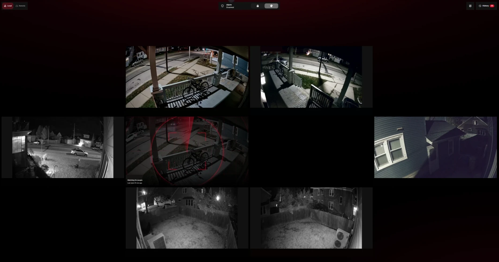
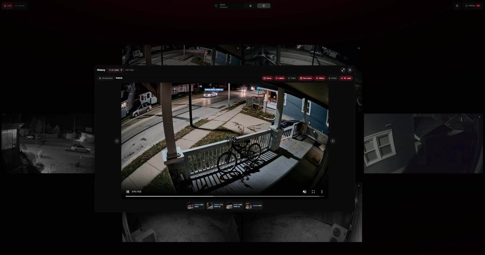

# Protect Detections

A Home Assistant custom integration that brings UniFi Protect's smart detections to your dashboards, together with the cards that show them:

- **Camera wall** – a screen-fitting wall of live camera feeds that you can arrange, with a live dialog (zoom, two-way talk, live boxes) and a detection history.
- **Detection history** – a lightbox of past detections that plays Protect's recording with Protect's own boxes drawn frame by frame.
- **Tracking card** – stands by with no video until a camera tracks a person, then shows that camera live and zoomed in on them.

It is a companion to Home Assistant's built-in **UniFi Protect** integration. It uses that integration's existing connection and login, and holds no credentials of its own.

> **Unofficial.** This project is not affiliated with Ubiquiti. Parts of it use interfaces of UniFi Protect that are not documented (the same ones Protect's own web app uses). A Protect update can change or remove them; features that depend on them then stop working until this integration is updated.

## Screenshots

| | |
|---|---|
|  |  |
| The camera wall, with a tracking tile standing by | A camera's live dialog, with zones |
|  |  |
| The detection history | A detection's recording, with Protect's boxes |

Camera and zone names are painted out in these pictures.

## Requirements

- Home Assistant 2026.3 or newer.
- The built-in **UniFi Protect** integration, set up and working.
- The **Protect Zones** custom integration (see [Companions](#companions)). Protect Detections uses the shared connection to Protect that Protect Zones provides and cannot be set up without it. Only its files need to be installed; you do not have to add it under Devices & services (though you will want to, for the zone features).
- For recorded clips: `ffmpeg`, which Home Assistant already ships.
- For live video in the cards: Home Assistant's own camera streaming (WebRTC through go2rtc, which Home Assistant sets up by default).

## Installation

### HACS (custom repository)

1. Install **Protect Zones** first, the same way (its repository is listed under [Companions](#companions)).
2. In HACS, open the menu, choose **Custom repositories**, add `https://github.com/OnticEntia/protect-detections` and select the type **Integration**.
3. Find **Protect Detections** in HACS, download it, and restart Home Assistant.
4. Go to **Settings → Devices & services → Add integration**, search for **Protect Detections** and confirm.

### Manual

1. Copy the folder `custom_components/protect_detections` from this repository into the `custom_components` folder of your Home Assistant configuration.
2. Do the same for Protect Zones.
3. Restart Home Assistant and add the integration as in step 4 above.

### The cards need no setup

The cards are part of the integration. It serves them itself and tells Home Assistant to load them, so there is **no dashboard resource to add**. After installing or updating, refresh the browser once.

If you used an earlier version that had you add `camera-wall-card.js`, `protect-detection-card.js` or `protect-tracking-card.js` as dashboard resources, remove those resources.

## The cards

Every card works with just its `type:`. What is left out is looked up in Home Assistant.

### Camera wall

```yaml
type: custom:camera-wall-card
```

Best in a view of type *Panel*. With no options it shows one feed per UniFi Protect camera (by name), the alarm panel if there is one, a History button, and a Local / Remote switch when Home Assistant knows both its internal and external address.

- **Tap a feed** to open it in a dialog: digital zoom (wheel, pinch, drag), HD toggle, two-way talk on cameras with a speaker, and a *Boxes* button on cameras that recognise things.
- **Arrange** (the button beside History): drag feeds to any cell of a grid, resize them, add or remove rows and columns. On a phone the wall is a list and arranging changes its order.
- **Right-click** (press and hold on a touch screen) for a menu: resize a tile, take it off the wall or put it back, add or remove a camera's tracking tile.
- The arrangement is saved for each Home Assistant user and follows them to every device.

| Option | Default | What it does |
|---|---|---|
| `cameras` | found | A list of `{entity, tap_entity, name}` to use instead of the cameras that are found. `entity` is shown on the wall, `tap_entity` in the dialog. |
| `exclude` | – | Found cameras to leave out: names (`*` and `?` allowed), entity ids or device ids. |
| `order` | by name | Found cameras to put first, in this order. |
| `alarm` | found | An `alarm_control_panel` entity, or `false` for none. |
| `alarm_modes` | `[armed_home, armed_away, disarmed]` | The modes offered. |
| `history` | found | A camera list like `cameras` for the History lightbox, or `false` for none. |
| `local_url`, `remote_url` | from Home Assistant | The two addresses for the Local / Remote switch, or `false`. |
| `aspect_ratio` | `1.7778` | Width / height of each feed. |
| `breakpoints` | `[[1024, 3], [600, 2], [0, 1]]` | `[minimum screen width, columns]`. |
| `arrange` | `true` | `false` hides the Arrange button. |
| `layout` | `default` | A name for this wall's saved arrangement, if you have several walls. |
| `tracking` | on | `false` for no tracking tiles, or options for them (see the tracking card), e.g. `{types: [person], stream: low}`. |
| `live_tracks` | `true` | `false` hides the Boxes button. |
| `live_delay` | `700` | Milliseconds the live picture is held back while Boxes is on, so boxes line up with it. |
| `live_offset` | `0` | Milliseconds to draw the boxes later (+) or earlier (−). |
| `zone_overlay` | `true` | `false` never shows zones (needs Protect Zones' overlay). |
| `phone_landscape` | `true` | `false` keeps the dialog upright on a phone. |

### Detection history

```yaml
type: custom:protect-detection-card
```

Takes no space on the page by itself; the camera wall creates one for its History button. On its own it is opened by another card or script calling `open()` on it. The lightbox lists finished detections with Protect's best photo of each object, filtered by kind, for the last 7 days or a chosen day. Tapping one plays Protect's recording with boxes, labels, paths, a face close-up, the boxes of other detections at the same moment, and *Follow* (zoom in on what was detected).

| Option | Default | What it does |
|---|---|---|
| `cameras` | found | A list of `{entity, tap_entity, name}`. |
| `exclude`, `order` | – | As on the camera wall. |
| `aspect_ratio` | `1.7778` | Width / height of the player. |
| `protect_url` | from the camera's device | The address of your Protect console, for the link on a detection's id. |
| `protect_event_url` | `{base}/protect/events/event/{id}` | The pattern of that link (`{base}`, `{id}`, `{camera}`), or `false` for no link. |

### Tracking card

```yaml
type: custom:protect-tracking-card
```

Watches every camera that recognises things and shows whichever one sees a person first. While standing by no video plays: it shows a still picture and a scanner animation.

| Option | Default | What it does |
|---|---|---|
| `camera` | all that recognise things | One camera entity to watch. |
| `types` | `[person]` | What to react to: `person`, `vehicle`, `animal`, `package`. |
| `show_others` | `false` | Also box other things, faintly. |
| `name` | the camera's | Shown while standing by. |
| `linger` | `10` | Seconds the picture stays after the last sighting. |
| `standby` | `radar` | The standing-by look: `radar`, `pulse`, `scanline` or `none`. |
| `accent` | the theme's primary colour | The scanner's colour. |
| `snapshot` | `60` | Seconds between still pictures while standing by; `0` for none. |
| `warm` | `false` | Keep the stream running unseen so the picture is instant. Uses that stream all the time. |
| `stream` | `auto` | `auto` (best stream on the home network, lighter one elsewhere), `high` or `low`. |
| `max_zoom` | `4` | How far it zooms in. |
| `aspect_ratio` | `1.7778` | Width / height, where the view does not set the height. |
| `height` | – | A fixed height instead (`300`, `300px`, `40vh`). |
| `live_delay`, `live_offset` | `700`, `0` | As on the camera wall. |

In a *Sections* view the card can be dragged to any width and height.

## Companions

Both are optional features of the cards, but see the note on Protect Zones.

- **[Protect Zones](https://github.com/OnticEntia/protect-zones)** – **required** for this integration to load, because it provides the connection to Protect that both share. It also adds what the cards use for zones: the zone overlay in the camera dialog, zone editing for administrators, "occupied" badges on the wall, and zone names in the tracking card.
- **[Protect Rules](https://github.com/OnticEntia/protect-rules)** – rules on top of detections. Its card uses this integration's clip player. Not needed otherwise.

HACS installs one repository at a time and does not install Protect Zones for you. If it is missing, adding Protect Detections stops with "Protect Zones isn't installed"; an entry that already exists fails to set up with the same message and a notice appears under **Settings → Repairs**. Install Protect Zones, restart Home Assistant, and reload Protect Detections.

## Privacy and security

- **Everything stays local.** The integration talks only to your Protect console, through the UniFi Protect integration's session. Nothing is sent anywhere else.
- **It relays camera data to dashboards.** Any logged-in Home Assistant user can see detections, object photos, recorded clips and live positions through this integration, and can talk through a camera's speaker. It does not add per-user restrictions of its own. Give dashboard access accordingly.
- **Clips are written to disk.** A played clip is exported from Protect into the system's temporary folder on the Home Assistant machine. Only the newest 24 clips are kept (600 MB at most), and the folder is emptied when the integration starts and stops.
- **Talk** sends your browser's microphone audio to the camera's speaker. Browsers only allow the microphone over https; on a plain http address the wall opens a small talk window on your https address instead.
- **The card files are public**, like Home Assistant's own frontend files: they contain code only, no data, and are served without a login.
- **Nothing is written to Protect** by this integration. (Zone editing is done by Protect Zones and is limited to administrators there.)

## Troubleshooting

| Symptom | What to check |
|---|---|
| "Set up the UniFi Protect integration first" | The built-in UniFi Protect integration must be set up and loaded. |
| "Protect Zones isn't installed" (when adding, on the entry, or under Repairs) | Install Protect Zones, restart Home Assistant, then add or reload Protect Detections. |
| "Custom element doesn't exist" for a card | Refresh the browser (clear its cache if needed) after installing or updating. Check that the integration is loaded. |
| A card shows twice-defined errors in the browser console | Remove old dashboard resources pointing at these cards; the integration loads them now. |
| No Boxes button, no tracking tile | The camera must recognise things (smart detections), and the integration must be a version with live tracking. |
| Boxes sit ahead of or behind the picture | Adjust `live_offset`. Browsers that cannot hold a live picture back draw the boxes late. |
| Clips do not play | The camera must be recording in Protect for the time of the detection. Some browsers cannot play HEVC; the card then asks for an H.264 copy, which takes a little longer. |
| No talk button | The camera needs a speaker, and the page must be on https (or the talk window is used). |
| Something stopped working after a Protect update | Protect's undocumented interfaces may have changed. Please open an issue with your Protect and Home Assistant versions. |

## Development

The cards are plain JavaScript modules in `custom_components/protect_detections/frontend/`, with no build step. Their tests run in Node without a browser:

```bash
node tests/cards.test.mjs
```

## Licence

MIT. See [LICENSE](LICENSE).
